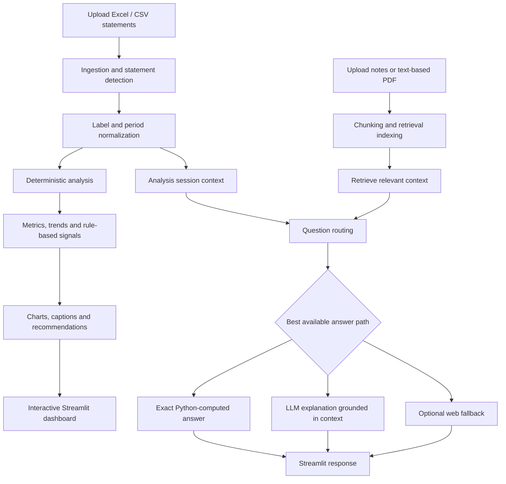

# NexusAI — Intelligent Analytics & Knowledge Platform

> **A modular AI-powered analytics application that combines deterministic data processing, retrieval-augmented generation (RAG), document search, interactive visualizations, and grounded conversational analysis.**

NexusAI turns structured data and supporting documents into a single interactive workspace. Its current reference workflow focuses on financial statements, but the architecture is designed around reusable ingestion, normalization, analysis, retrieval, and explanation components rather than a finance-only chatbot.

**Current application status:** Streamlit prototype / portfolio project  
**Primary interface:** Streamlit web application  
**Entry point:** `app.py`

---

## Contents

- [Overview](#overview)
- [Why NexusAI](#why-nexusai)
- [Key capabilities](#key-capabilities)
- [How it works](#how-it-works)
- [Architecture](#architecture)
- [Technology stack](#technology-stack)
- [Repository structure](#repository-structure)
- [Getting started](#getting-started)
- [Configuration and API keys](#configuration-and-api-keys)
- [Using the application](#using-the-application)
- [Analysis and grounding principles](#analysis-and-grounding-principles)
- [Testing](#testing)
- [Security and privacy](#security-and-privacy)
- [Known limitations](#known-limitations)
- [Potential extensions](#potential-extensions)
- [Contributing](#contributing)
- [Disclaimer](#disclaimer)

---

## Overview

NexusAI is an interactive analytics and knowledge platform built to bring together two kinds of information:

1. **Structured data** — tabular data supplied through Excel workbooks or CSV files.
2. **Unstructured context** — supporting notes and documents that help explain the data.

The application processes uploaded data, maps source labels to a consistent schema, calculates metrics with Python, surfaces rule-based signals, creates interactive charts, and provides a conversational interface for asking follow-up questions.

The current implementation uses company financial statements as its primary example domain. It can analyze available income-statement, balance-sheet, and cash-flow data, while document Q&A provides additional context where supporting notes are available.

### Project goals

- Make multi-file data analysis accessible through a browser-based interface.
- Separate deterministic calculations from language-model-generated explanations.
- Handle variation in real-world spreadsheet labels and layouts.
- Make answers traceable to the supplied data and documents where possible.
- Provide useful fallback behavior when optional AI services are not configured or unavailable.
- Keep ingestion, normalization, analysis, charting, retrieval, and chat logic in separate modules.

---

## Why NexusAI?

A language model alone should not be responsible for every part of an analytical workflow. NexusAI separates the work into components with different responsibilities:

| Component | Responsibility |
|---|---|
| Data-processing layer | Reads files, identifies statement types and periods, and normalizes labels. |
| Calculation layer | Computes metrics, ratios, and trends using Python. |
| Signal-detection layer | Applies rule-based checks to identify patterns that may need review. |
| Visualization layer | Presents the data through interactive charts and contextual insights. |
| Retrieval layer | Searches relevant chunks from uploaded supporting documents. |
| Language-model layer | Explains retrieved context and computed results in natural language. |
| Optional web fallback | Can retrieve external context when configured and when the question needs it. |

This division helps reduce arithmetic errors and makes it easier to inspect, test, and improve individual parts of the application.

---

## Key capabilities

### 1. Structured-file ingestion

- Accepts Excel workbooks and CSV files for tabular statements.
- Detects statement type from content rather than relying exclusively on filenames.
- Attempts to identify the row containing reporting periods.
- Supports common fiscal-year and quarterly period labels.
- Supports partial datasets: available analysis depends on which statements are provided.

### 2. Label normalization

Spreadsheet labels often differ across organizations. The normalization layer maps source labels to a standard schema using exact and fuzzy matching.

For example, labels such as `Net Sales` and `Net Income / (Loss)` can be mapped to canonical fields when they are recognized by the configured aliases and matching logic.

Normalization is intended to make downstream calculations consistent while retaining the need to validate unfamiliar or ambiguous labels.

### 3. Deterministic analysis

Metrics are calculated with Python rather than delegated to the LLM. Depending on the fields available, analysis can include:

- Revenue and earnings trends
- Profitability margins
- Liquidity ratios
- Leverage and solvency ratios
- Efficiency measures
- Period-over-period comparisons
- Rule-based anomaly and red-flag signals
- Cash-flow and payout analysis when the relevant statements are supplied

A metric is only as reliable as the underlying data, the field mapping, and the formula used. Missing inputs should not be interpreted as zero unless the application explicitly defines that behavior.

### 4. Interactive visualizations

- Uses Plotly-based charts for exploring trends and relationships.
- Selects chart styles through a dedicated charting module.
- Associates charts with explanatory captions or insights.
- Presents an executive-style summary and suggested actions where supported by the available analysis.

### 5. Document-grounded question answering

Users can add supporting notes to ask contextual questions that cannot be answered from tables alone.

The documented workflow supports text files, Markdown files, and PDFs with selectable text. Documents are chunked, embedded or indexed through the configured retrieval path, and searched for relevant context before an answer is generated.

The retrieval workflow uses Qdrant and can use Voyage AI embeddings when the corresponding configuration is present.

### 6. Conversational analysis

The chat interface is designed to support follow-up questions and route them to the most appropriate available source:

- **Exact figure:** deterministic answer based on the processed dataset.
- **Document-grounded answer:** response based on the supplied data and retrieved notes.
- **Web-sourced answer:** external information when the web fallback is configured and used.
- **General-knowledge answer:** clearly distinguished from source-grounded analysis when applicable.
- **Limited mode:** relevant available material or a fallback response when an optional service is unavailable.

Source labels describe the intended answer path; users should still inspect cited evidence and verify important conclusions.

### 7. Optional external services

The application can integrate with external services for language-model responses, embeddings, and web search. These integrations are optional so that core data processing and deterministic analysis can remain useful without all keys configured.

---

## How it works



### Typical request lifecycle

1. A user uploads one or more supported files.
2. The ingestion module reads the files and identifies the available statements and periods.
3. The normalization module maps source labels into canonical fields.
4. The analysis pipeline computes metrics and rule-based findings.
5. The UI displays available metrics, charts, insights, and recommendations.
6. For a question, the chat layer determines whether a deterministic result, retrieved context, or an optional external source is appropriate.
7. The response is returned in the Streamlit interface with source information where supported.

---

## Architecture

The application is organized into modules so that file processing, calculations, retrieval, and user interaction can be maintained independently.

| Module | Responsibility |
|---|---|
| `app.py` | Streamlit entry point and primary user interface. |
| `src/ingest.py` | Reads Excel/CSV inputs, identifies reporting-period headers, and detects statement type. |
| `src/normalize.py` | Maps raw spreadsheet labels to the standard schema using exact and fuzzy matching. |
| `src/analysis.py` | Computes ratios, trends, and rule-based anomaly findings using Python. |
| `src/chart_engine.py` | Builds Plotly visualizations. |
| `src/chart_insights.py` | Produces chart captions and final recommendations. |
| `src/insight_engine.py` | Generates the executive summary and fallback content. |
| `src/doc_chunker.py` | Splits supporting documents into retrievable chunks. |
| `src/doc_embedder.py` | Handles document embedding functionality. |
| `src/doc_retrieve.py` | Retrieves relevant document chunks through the configured retrieval backend. |
| `src/web_search.py` | Provides optional Tavily-backed web search fallback. |
| `src/chat_engine.py` | Routes questions, assembles context, handles conversation state, and streams responses. |
| `src/pipeline.py` | Connects file ingestion to the analysis session. |
| `data/sample/` | Sample datasets used for demonstration and testing. |
| `tests/` | Test scripts for pipeline, chat behavior, and the app flow. |

> **Note:** This is the expected high-level layout from the project documentation. If your local folder contains additional modules or different filenames, keep the README synchronized with the actual repository before publishing.

---

## Technology stack

The following technologies are part of the documented implementation or its optional integrations.

| Technology | Role |
|---|---|
| Python | Core application logic and deterministic calculations. |
| Streamlit | Interactive web interface. |
| Pandas | Tabular data ingestion and transformation. |
| Plotly | Interactive charts and visual exploration. |
| Groq API | Optional LLM-powered responses and language-model explanations. |
| Qdrant | Vector retrieval for supporting documents. |
| Voyage AI | Optional embedding service for document search. |
| Tavily | Optional web-search fallback. |
| Excel / CSV | Structured data input formats. |
| TXT / Markdown / text-based PDF | Supporting-document formats. |
| `python-dotenv` | Local environment-variable configuration, if included in the installed dependencies. |
| `pytest` / Python test scripts | Test execution, depending on the project's configured test setup. |

The exact package versions should be taken from the project's dependency file. This README intentionally does not invent pinned versions.

---

## Repository structure

A typical project layout is shown below:

```text
nexus-ai/
├── app.py
├── README.md
├── requirements.txt
├── .env.example
├── .gitignore
├── setup.bat
├── run.bat
├── setup.sh
├── run.sh
├── src/
│   ├── ingest.py
│   ├── normalize.py
│   ├── analysis.py
│   ├── chart_engine.py
│   ├── chart_insights.py
│   ├── insight_engine.py
│   ├── doc_chunker.py
│   ├── doc_embedder.py
│   ├── doc_retrieve.py
│   ├── web_search.py
│   ├── chat_engine.py
│   └── pipeline.py
├── data/
│   └── sample/
└── tests/
    ├── test_pipeline.py
    ├── test_chat.py
    └── test_app.py
```

This is a documentation template based on the earlier project layout. Preserve the files that exist in your current working tree; do not create empty modules just to match this diagram.

---

## Getting started

### Prerequisites

- Python 3.10 or newer, as specified by the original project documentation.
- Git, if you plan to clone or contribute to the repository.
- API keys only for optional integrations that you intend to use.
- Internet access for installing packages and using configured hosted APIs.

### Option A — Windows setup scripts

If the project includes the setup scripts:

```powershell
.\setup.bat
```

After setup finishes:

```powershell
.\run.bat
```

### Option B — Manual setup

Open a terminal in the project root.

**Windows PowerShell**

```powershell
py -m venv .venv
.\.venv\Scripts\Activate.ps1
python -m pip install --upgrade pip
pip install -r requirements.txt
streamlit run app.py
```

If PowerShell blocks activation, you can run the environment's Python directly:

```powershell
.\.venv\Scripts\python.exe -m pip install -r requirements.txt
.\.venv\Scripts\python.exe -m streamlit run app.py
```

**macOS / Linux**

```bash
python3 -m venv .venv
source .venv/bin/activate
python -m pip install --upgrade pip
pip install -r requirements.txt
streamlit run app.py
```

The app normally opens at:

```text
http://localhost:8501
```

If the repository's `setup.bat`, `run.bat`, `setup.sh`, or `run.sh` scripts use a different virtual-environment name or install command, follow the scripts included in your current project.

---

## Configuration and API keys

Create a local `.env` file from `.env.example` if the project provides one. Add only the keys for integrations you want to enable.

```dotenv
# Required for LLM-backed chat and AI-generated explanations
GROQ_API_KEY=your_groq_api_key
GROQ_MODEL=openai/gpt-oss-20b

# Optional document embedding integration
VOYAGE_API_KEY=your_voyage_api_key

# Optional web-search fallback
TAVILY_API_KEY=your_tavily_api_key
```

### Configuration notes

- **Groq:** Enables LLM-powered explanations and chat. `GROQ_MODEL` selects the model used by the application; the model must be supported by the configured Groq endpoint.
- **Voyage AI:** Enables the configured embedding workflow if the project is set up to use it.
- **Tavily:** Enables optional web search when a question needs external information and the app routes it to that fallback.
- **Qdrant:** The project uses Qdrant in its document-retrieval design. Confirm whether your current configuration uses local/in-memory storage or a separately running service before deploying.

Restart the app after changing environment variables.

**Never commit `.env`, API tokens, private documents, or credentials to GitHub.** Keep `.env.example` limited to placeholder values. Rotate any key that was accidentally published.

---

## Using the application

### 1. Load sample data

If the sample-data feature is available in the current build, use it to explore the dashboard before uploading your own files.

### 2. Upload structured statements

Use an Excel workbook with separate sheets for the available statements, or upload CSV files as supported by the interface.

Recommended inputs:

- Income statement
- Balance sheet
- Cash flow statement

The header row should contain recognizable reporting periods, such as `FY2024` or `Q1 2025`, based on the formats recognized by the ingestion code.

### 3. Add supporting documents

Upload supported text-based notes or documents, such as `.txt`, `.md`, or a PDF containing selectable text. These files can provide narrative context for questions about the numbers.

### 4. Explore the dashboard

Review the available metrics, ratios, trends, charts, captions, and rule-based findings. Results depend on the statements and fields that were successfully detected.

### 5. Ask questions in chat

Examples of useful questions include:

- `What was revenue in FY2024?`
- `How did net margin change across the reporting periods?`
- `Compare revenue growth with operating cash-flow growth.`
- `What factors could explain the difference between net income and operating cash flow?`
- `Which liquidity or leverage indicators should be reviewed?`
- `Summarize the most important trends and recommend actions.`

Use questions that identify the reporting period, metric, or comparison you care about. For important decisions, verify the answer against the displayed figures and cited source material.

---

## Analysis and grounding principles

### Deterministic calculations first

Financial metrics should be computed from normalized values using explicit Python formulas. The language model is used to explain results, not to replace the calculation engine.

### Keep cash-flow concepts separate

These are different measures and should not be treated as interchangeable:

- **Operating cash flow (OCF):** cash generated or used by operating activities.
- **Cash after capital expenditure and dividends:** a derived measure that subtracts the magnitudes of capital expenditure and dividends from OCF, when the relevant values are available.
- **Net change in cash:** the reported or computed change after operating, investing, and financing cash flows, subject to the source statement's sign conventions.

A positive residual after capex and dividends does not mean that the residual alone covers those outflows. It means the operating cash flow exceeded those outflows by that residual amount.

### Source-aware answers

Responses should distinguish exact computed figures from document-based explanations and external information. A generated explanation can still be incomplete or incorrect; source labels do not guarantee correctness.

### Missing information

If a required statement or field is absent, the application should limit its conclusions rather than silently infer missing values. Rule-based findings are screening signals that warrant review, not proof of an underlying cause.

---

## Testing

The original project documentation describes the following test scripts. Run the ones that are present in your current checkout.

```powershell
python tests/test_pipeline.py
python tests/test_chat.py
python tests/test_app.py
```

Or, on macOS/Linux:

```bash
python tests/test_pipeline.py
python tests/test_chat.py
python tests/test_app.py
```

The documented test areas include:

- File ingestion and statement detection
- CSV handling and invalid-input behavior
- Chat routing for exact figures, document questions, web fallback, and limited/no-key modes
- UI flow and failure handling

A successful local test run does not replace testing the app with real credentials and representative user files. External API behavior can change independently of the local code.

---

## Security and privacy

Before publishing or deploying the project:

- Keep `.env` out of version control.
- Include `.env.example` with placeholders only.
- Add `.venv/`, `venv/`, `__pycache__/`, `.streamlit/secrets.toml`, local databases, generated indexes, and private uploads to `.gitignore` where applicable.
- Do not commit real company financial statements or sensitive documents without authorization.
- Review logging and error messages to ensure they do not expose API keys or private content.
- Treat uploaded financial data as sensitive and use only data you are authorized to process.
- Check the terms and privacy policies of any external LLM, embedding, vector database, or web-search provider before sending data to it.

The application is documented as a single-user, in-memory prototype. Do not assume that it provides authentication, durable storage, tenant isolation, or production-grade access controls unless these have been implemented and tested in the current code.

---

## Known limitations

- **PDF support:** the documented workflow handles selectable text; scanned images and complex PDF tables may not be parsed correctly. Use Excel or CSV for statement tables.
- **Input quality:** incorrect headers, ambiguous labels, inconsistent units, or incomplete statements can affect normalization and calculations.
- **Fuzzy mapping:** label matching can choose an unintended field for unfamiliar labels; inspect the normalized output when available.
- **LLM reliability:** a model can misinterpret context or produce unsupported explanations even when instructed to stay grounded.
- **External-service availability:** chat, embeddings, and web fallback depend on the relevant credentials, network access, provider availability, and model configuration.
- **Session persistence:** the documented design uses in-memory, single-user sessions; data may not persist between runs.
- **Rule-based findings:** thresholds are heuristic screening rules, not audited conclusions.
- **Deployment hardening:** production use may require authentication, persistent storage, monitoring, rate limiting, and stronger data-isolation controls.

---

## Potential extensions

These are possible future improvements, not claims about features already implemented:

- Multi-format document understanding, including scanned PDFs and image-based tables.
- More robust schema mapping with user-confirmed corrections.
- Evaluation datasets for retrieval quality, answer faithfulness, and refusal behavior.
- Explicit calculation provenance so every derived metric can be traced to inputs and formulas.
- Agent orchestration for multi-step workflows, if introduced and evaluated.
- Additional structured-data connectors and domain-specific analysis modules.
- Persistent sessions, user authentication, and multi-user access controls.
- Deployment automation, observability, and performance monitoring.

---

## Contributing

Contributions and improvements are welcome.

1. Create a branch for your change.
2. Keep calculations deterministic and testable.
3. Add tests for new parsing, normalization, analysis, or routing behavior.
4. Keep API keys and private data out of commits.
5. Update the README when behavior, dependencies, setup, or limitations change.
6. Run the relevant tests before opening a pull request.

---

## Disclaimer

NexusAI is an educational and portfolio-oriented software project. Its current financial-analysis workflow is for informational and analytical exploration only. It is not accounting, audit, legal, tax, or investment advice. Validate source data and calculations independently before relying on any output for a business or financial decision.

---

## Author

**Maharsh Shah**

If you use or extend this project, please retain appropriate attribution and review the repository's license before redistributing it.
